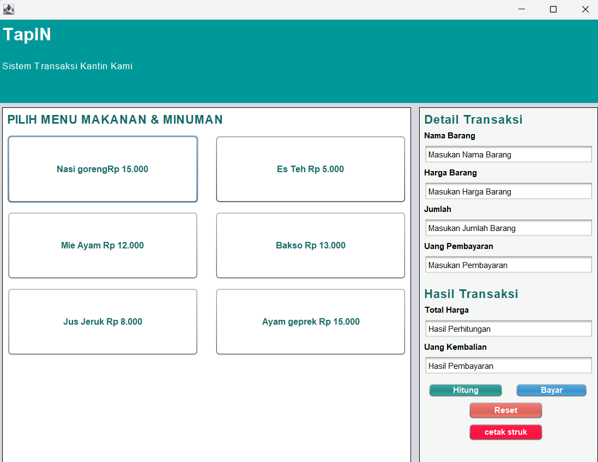
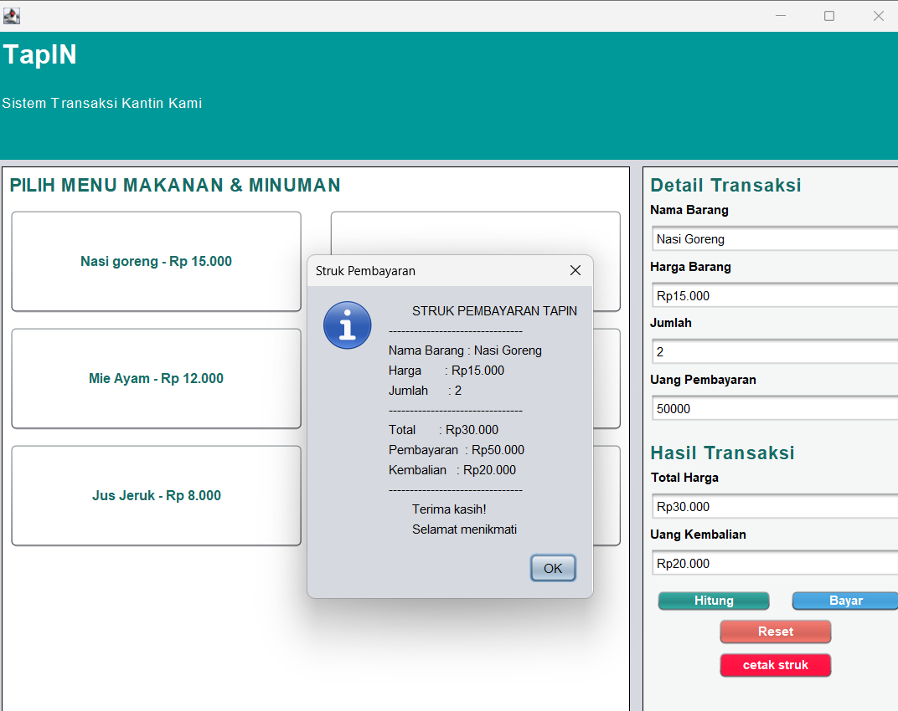
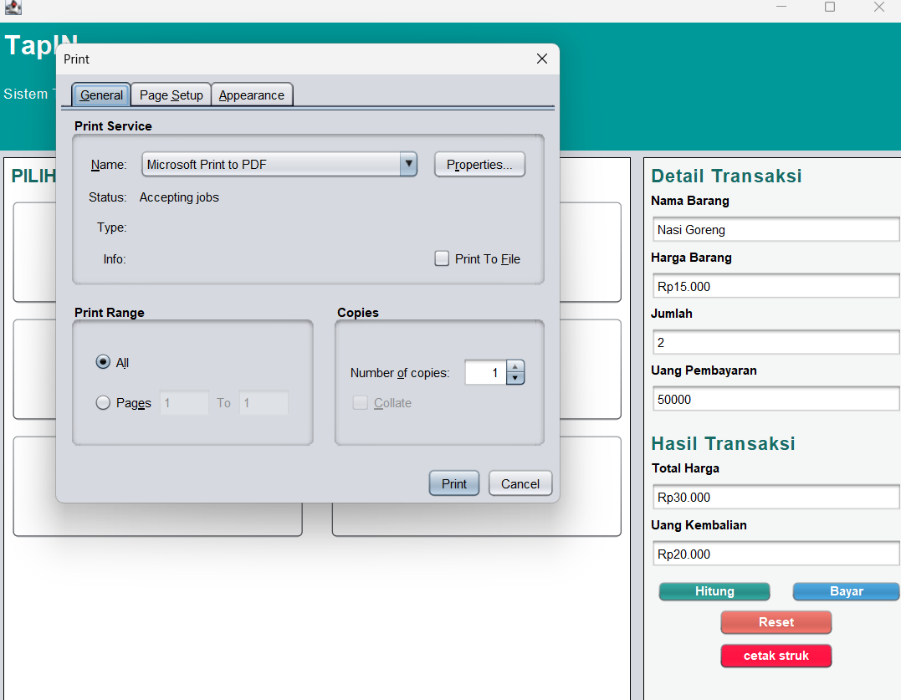

TapIN – Aplikasi Kasir Kantin Kampus

A.	Identitas Mahasiswa
Nama			          : Desi Nuryani
NIM 			          : C2483207006
Kelas 			        :PT15A
Program Studi 		  : Pendidikan Teknologi Informasi
Mata Kuliah 		    : Pemrograman Visual
Nama Aplikasi 		  : TAPIN (Kasir Kantin Kampus)
Deskripsi Aplikasi	:
TAPIN merupakan aplikasi kasir sederhana berbasis Java Swing yang digunakan untuk membantu proses transaksi pembelian di kantin kampus. Aplikasi ini memiliki fitur pemilihan produk, perhitungan total harga, pembayaran, perhitungan uang kembalian, serta pencetakan struk transaksi.
Nama TapIN sendiri saya terinspirasi dari banyaknya pengguanaan qris sebagai media pembayaran saat ini. Selaras dengan tujuan dari aplikasi kasir ini untuk mempermudah maka saya ambil nama TapIN. 
Aplikasi dibuat menggunakan Apache NetBeans IDE dengan bahasa pemrograman Java.

B.	Fitur Aplikasi

1. Menampilkan daftar produk dan harga.
2. Memilih produk yang ingin dibeli.
3. Menginput jumlah barang.
4. Menghitung total harga secara otomatis.
5. Menginput jumlah uang pembayaran.
6. Menghitung uang kembalian.
7. Menampilkan struk pembayaran.
8. Mencetak struk transaksi.
9. Mereset form untuk transaksi berikutnya.

C.	Komponen Java Swing yang Digunakan

JFrame		: Sebagai jendela utama aplikasi.
JPanel		: Mengatur tata letak tampilan aplikasi.
JLabel		: Menampilkan judul dan keterangan.
JButton		: Menjalankan perintah seperti memilih produk, hitung, bayar, reset, dan cetak struk.
JTextField	: Menginput dan menampilkan data transaksi.
JOptionPane	: Menampilkan pesan dan struk pembayaran.
JTextArea	: Menyusun teks struk yang akan dicetak.

D.	Tampilan Aplikasi

1. Tampilan Utama

3. Hasil Perhitungan Total

4. Hasil Pembayaran dan Uang Kembalian

Cara Menjalankan Aplikasi

1. Pastikan Java Development Kit (JDK) dan Apache NetBeans IDE sudah terpasang.
2. Download atau clone repository ini.
3. Buka Apache NetBeans IDE.
4. Pilih File → Open Project.
5. Pilih folder proyek TAPIN yang sudah diunduh.
6. Tunggu hingga proyek selesai dimuat.
7. Klik kanan pada project, kemudian pilih Run File
8. Aplikasi TAPIN siap digunakan.
